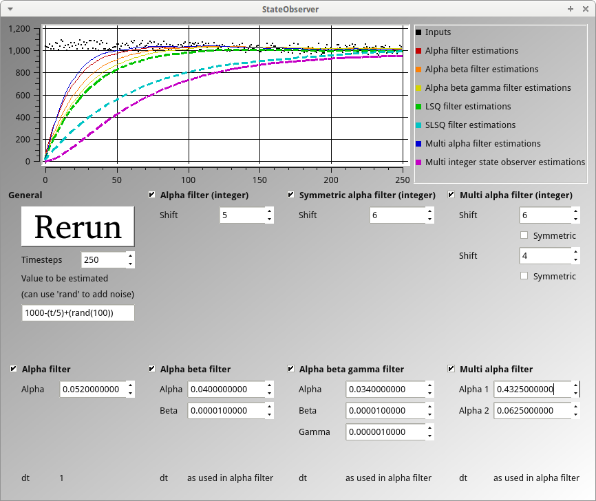

# StateObserver

Examine state observers.

StateObserver is one of [Richèl Bilderbeek's tools](https://richelbilderbeek.github.io/tools/).

## Links

- [Source code](https://github.com/richelbilderbeek/StateObserver)
- [Richèl Bilderbeek's tools](https://richelbilderbeek.github.io/tools/)
